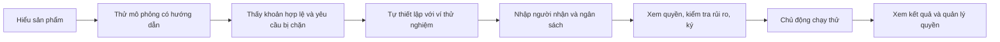

# Kế hoạch cải thiện trải nghiệm REDLINE cho hackathon

Ngày lập: 27/10/2026. Phạm vi: lập kế hoạch dựa trên source hiện tại sau P0–P2; chưa sửa giao diện trong đợt rà soát này.

Cập nhật triển khai: người dùng đã duyệt làm mục 1–4. Bốn nhóm giao diện đã được triển khai local; xem [kết quả UX](UX_FIRST_USE_IMPLEMENTATION.md). Phần thử với người dùng mới và các mục tiêu usability bên dưới vẫn cần kiểm chứng thực tế.

## 1. Quyết định sản phẩm

Ưu tiên người lần đầu mở ứng dụng hoặc xem demo hackathon. Tác vụ trung tâm: **hiểu cách REDLINE giới hạn thanh toán của agent, thử một tình huống, rồi tự thiết lập nếu muốn**.

P0–P2 đã bổ sung độ đúng, phục hồi giao dịch, mẫu/nháp, lịch sử, báo cáo và thông báo. Đợt tiếp theo cần tổ chức lại cách tiếp cận những chức năng này. Số test kỹ thuật và việc không tràn ngang chưa chứng minh người mới biết dùng ứng dụng.

Giả định cho bản trình diễn: giới thiệu giá trị sản phẩm trong khoảng ba phút; luồng thanh toán có ví tiếp tục dùng Devnet/dUSDC và khả năng thực thi đang có. Lịch triển khai sẽ phụ thuộc thời hạn hackathon và kết quả thử người dùng.

## 2. Vấn đề có bằng chứng từ source

| Quan sát hiện tại | Vì sao có thể làm người mới lúng túng | Source liên quan |
| --- | --- | --- |
| Tổng quan đặt ba ô số liệu trước phần bắt đầu; khi chưa đăng nhập các ô hiện dấu gạch. | Màn đầu đưa ra thông tin người dùng chưa có, trong khi chưa giải thích rõ họ nên thử gì. | `components/OverviewPage.tsx` |
| Bản mô phỏng không cần ví nằm trong phần đóng ở cuối trang. | Cách nhanh nhất để hiểu sản phẩm khó được tìm thấy. | `OverviewPage.tsx`, `PolicyLab.tsx` |
| Policy Lab có preset, số lần thử, khoảng cách, nonce và bảy gate. | Đưa toàn bộ công cụ kiểm thử ra trước có thể tạo thêm một biểu mẫu khó học. | `PolicyLab.tsx` |
| Trang Agent mặc định lọc theo quan hệ với ví; người chưa đăng nhập có thể thấy danh sách trống, cùng hành động xuất bản phiên bản. | Người đến để dùng thử chưa biết cách chọn agent hoặc tại sao phải xuất bản. | `frontend/Pages.tsx`, `ArtifactAgents` |
| Builder có bốn bước: agent/người nhận, ngân sách, lịch, xem lại; mẫu, nháp, thuê và kiểm tra rủi ro cùng xuất hiện trong luồng. | Người mới phải hiểu nhiều khái niệm và tự nối các bước qua nhiều trang. | `OperationalPages.tsx`, `SessionsPage` |
| Runtime `scriptedPlan` hiện tạo ba thanh toán hợp lệ, mỗi khoản bằng 20% tổng ngân sách; một số mô tả UI vẫn nói có yêu cầu vượt ngân sách. | Người dùng chờ một kết quả khác với hành vi thực tế; demo khó giải thích và giảm độ tin cậy. | `backend/src/runtime/scripted.ts`, `GrantsPanel.tsx`; cần rà thêm `GrantSignButton.tsx` và bản dịch |
| Quy trình phản hồi hiện có thiên về người vận hành treasury và nhà phát triển; yêu cầu tạo chính sách nguy hiểm và xem Memo proof. | Chưa trực tiếp đo được việc người mới tự hiểu, bắt đầu và hoàn thành tác vụ trên bản ứng dụng hiện tại. | `docs/USER_FEEDBACK.md` |

Đây là chẩn đoán từ source và ảnh QA cũ, chưa phải kết quả quan sát người dùng mới hoặc kiểm tra bản đang được ban giám khảo sử dụng. Cần đối chiếu commit/bản deploy thực tế trước khi trình diễn.

## 3. Luồng đầu tiên đề xuất

Màn đầu đề xuất:

- Tiêu đề: **Cho agent thanh toán trong hạn mức bạn kiểm soát.**
- Một câu giải thích: **Bạn chọn ngân sách và người nhận; yêu cầu ngoài quyền được cấp sẽ bị chặn.**
- Nút nổi bật: **Thử trong 1 phút** — ghi rõ mô phỏng, không cần ví, không chuyển tiền.
- Hành động phụ: **Tự thiết lập với ví thử nghiệm**.
- Bên dưới là một ví dụ trực quan: ngân sách 100 dUSDC → thanh toán giả định 20 được phép → còn 80 → yêu cầu 120 bị chặn.

Ví dụ trên là mô phỏng minh họa, không dùng làm bằng chứng giao dịch thật. Khi chuyển sang Devnet phải hiển thị rõ chế độ, ví, người nhận, quyền sẽ ký và trạng thái xác nhận.

## 4. Backlog theo thứ tự ưu tiên

### UX-01 — Sửa câu chuyện và màn đầu

**Làm trước.**

- Rà toàn bộ mô tả lượt chạy, đồng bộ EN/VI với runtime hiện tại. Demo có ví nói rõ ba khoản hợp lệ; minh họa yêu cầu bị chặn diễn ra trong mô phỏng.
- Đưa nút thử không cần ví lên vùng nhìn thấy đầu tiên ở desktop và mobile.
- Với người chưa có dữ liệu: ưu tiên ví dụ và hành động bắt đầu; các số liệu trống chuyển xuống dưới hoặc chưa hiển thị.
- Với người quay lại: ưu tiên agent đang chạy, việc cần xử lý, số dư và lượt chạy gần nhất. Dùng điều kiện trạng thái rõ ràng; không hỏi thêm một câu chọn vai trò trước khi dùng.
- Giữ nhận diện navy/gold; tăng phân cấp tiêu đề, khoảng trắng, độ tương phản chữ phụ. Mỗi vùng tác vụ có một nút chính.

**Nghiệm thu đề xuất:** trong vòng thử, ít nhất 4/5 người mô tả được sản phẩm sau 20 giây và tìm được cách thử trong 10 giây, không được chỉ vị trí nút.

### UX-02 — Bản thử có hướng dẫn, ít lựa chọn

- Tái sử dụng Policy Lab và API mô phỏng hiện có; bổ sung phần trình diễn đơn giản ở phía trước.
- Cho người dùng chạy hai tình huống có sẵn: **Trong ngân sách** và **Vượt ngân sách**. Mỗi tình huống chỉ cần một thao tác.
- Kết quả trả lời ba câu: yêu cầu bao nhiêu, vì sao được phép/bị chặn, ngân sách giả định còn bao nhiêu.
- Preset nâng cao, nonce, interval và kết quả từng gate nằm trong **Tùy chỉnh / Xem cách kiểm tra**.
- Nếu dịch vụ chưa sẵn sàng: giải thích ngắn gọn, cho thử lại. Có thể chuẩn bị bản minh họa dự phòng được ghi nhãn rõ; không thay dữ liệu live bằng kết quả dựng sẵn mà không thông báo.

**Nghiệm thu đề xuất:** ít nhất 4/5 người hoàn tất bản thử trong 90 giây và phân biệt được mô phỏng với giao dịch Devnet. Một người hiểu nhầm đã chuyển tiền thật là lỗi cần sửa trước khi trình diễn.

### UX-03 — Thiết lập theo tác vụ, giảm bước bắt buộc

- Làm một luồng liên tục gồm ba phần: **Người nhận & ngân sách → Xem lại quyền → Ký & theo dõi**.
- Giữ agent mặc định có giải thích, dựa trên build khả dụng/đủ điều kiện; cho đổi agent khi cần. Không tự chọn agent phải trả phí hoặc tự thuê.
- Người mới chỉ nhập địa chỉ người nhận và tổng ngân sách; tên gợi nhớ là tùy chọn. Số lệnh, khoảng cách và thời hạn có mặc định hiển thị rõ, có thể mở để chỉnh.
- Dùng ô số tiền nhập trực tiếp, kèm một số mức mẫu; slider là tùy chọn phụ nếu còn hữu ích.
- Nút **Kiểm tra và xem lại** chạy đánh giá rồi trình bày kết quả trên cùng luồng; không yêu cầu người mới tự tìm nút “AI risk assessment”. Vẫn giữ đầy đủ trạng thái BLOCK/REVIEW/ALLOW và xác nhận rủi ro khi cần.
- Trước khi mở ví luôn hiện tổng ngân sách, số lệnh, thời hạn, người nhận đầy đủ và yêu cầu ký. Nháp, bản sao chính sách, thuê và phục hồi tiếp tục giữ các kiểm tra P0–P2.
- Sau khi tạo thành công: một màn xác nhận với nút **Chạy thử agent này**, trạng thái số dư và lối xem chính sách. Nút chỉ hoạt động khi đủ điều kiện; không tự chạy sau khi ký.

**Nghiệm thu đề xuất:** người dùng không phải tự tìm qua menu để hoàn tất thiết lập; đổi địa chỉ/hạn mức hủy đánh giá cũ; không mất nháp khi đổi trang; không ký/gửi lại tự động khi lỗi.

### UX-04 — Trang agent và kết quả dễ đọc

- Trên điều hướng chính giữ khoảng bốn mục theo tác vụ: **Bắt đầu/Tổng quan · Agent của tôi · Quỹ · Lịch sử**. Chọn nhãn cuối cùng qua vòng thử; không đổi slug/URL cũ nếu không cần.
- Đặt cấu hình hạn mức trong tác vụ của agent và đường dẫn tạo mới. Marketplace, xuất bản, model và công cụ quản trị nằm trong lối vào phụ dành cho người cần dùng.
- Empty state Agent có **Dùng agent mẫu** hoặc **Khám phá agent có sẵn**, giải thích trước điều kiện thuê. Agent mẫu phải là build thực sự có sẵn; nếu chưa có thì dẫn sang mô phỏng, không tạo agent giả trong tài khoản.
- Thẻ agent trả lời: đang làm gì, còn được chi bao nhiêu, quyền hết hạn khi nào, hành động tiếp theo là gì.
- Kết quả lượt chạy có tóm tắt trước timeline: số thanh toán xác nhận, số yêu cầu bị chặn, số giao dịch lỗi, số chưa rõ kết quả. Tiền đã chuyển chỉ tính từ bằng chứng xác nhận và đúng mint; yêu cầu bị chặn không tính là tiền đã chuyển.
- Giữ chi tiết kỹ thuật, raw JSON, Explorer và báo cáo P2 trong các phần mở khi cần. Gộp cảnh báo liên quan để tránh một agent chiếm nhiều khối dài trên mobile.
- Phân biệt rõ **Dừng lượt chạy** với **Thu hồi quyền chi**; không gộp thành một nút mơ hồ. Giữ xác nhận cho thao tác thu hồi.

**Nghiệm thu đề xuất:** người mới tìm được kết quả lần chạy gần nhất và giải thích đúng “bị chặn có mất khoản tiền yêu cầu không”; biết dừng chạy khác với thu hồi quyền.

### UX-05 — Kiểm thử khả dụng và bản demo ổn định

- Đối chiếu bản deploy với source; rà dịch vụ mô phỏng, Devnet, RPC, ví thử và trạng thái khởi động backend trước buổi demo.
- Kiểm tra mobile 360/390px, desktop, bàn phím, focus, tên dài, mất mạng, ví chưa cài, hủy trong ví, phiên hết hạn và thao tác đang chờ xác nhận.
- Làm vòng thử với 5 người mới thuộc nhóm người dùng mục tiêu, sau đó sửa các điểm kẹt và thử lại với nhóm mới.
- Đo luồng ở cấp bước: vào trang → bắt đầu demo → xem kết quả → bắt đầu thiết lập → xem lại → ký → thanh toán xác nhận. Ghi thời gian, lần quay lại, chỗ cần trợ giúp; không đưa địa chỉ ví hoặc payload giao dịch vào dữ liệu usability.
- Kịch bản hackathon ba phút: nêu vấn đề → thử minh họa được phép/bị chặn → cho xem luồng thiết lập → mở một kết quả Devnet đã kiểm chứng và đối chiếu Explorer. Nếu dùng giao dịch có sẵn, ghi rõ đó là kết quả trước đó.

**Nghiệm thu:** có bản ghi quan sát và danh sách vấn đề thực tế, không dùng số test tự động hoặc ý kiến nội bộ để tuyên bố đã đạt usability.

## 5. Cách chia đợt thực hiện

| Đợt | Phạm vi | Kết quả cần xem được |
| --- | --- | --- |
| A — Giá trị trong phút đầu | UX-01, UX-02 | Người chưa có ví hiểu sản phẩm và tự chạy được bản thử ngắn. |
| B — Từ hiểu sang tự thiết lập | UX-03 | Một luồng liên tục từ điền người nhận/ngân sách đến xem quyền và ký. |
| C — Sử dụng hằng ngày | UX-04 | Agent, quyền và kết quả nằm trong cùng ngữ cảnh; menu và chi tiết bớt cạnh tranh. |
| D — Kiểm chứng và chỉnh tiếp | UX-05, thực hiện xen kẽ từng đợt | Quan sát người mới trước/sau, bản trình diễn ổn định và nội dung khớp hành vi thật. |

Nếu thời gian ngắn, ưu tiên A và một vòng thử trước khi mở rộng B/C. Không cần làm lại backend/on-chain chỉ để trình bày luồng mới; chỉ bổ sung API khi thiếu dữ liệu cần thiết cho kết quả đã xác minh.

## 6. Kịch bản thử người dùng

Đưa mục tiêu, không chỉ tên nút hoặc vị trí cần bấm:

1. “Hãy tìm hiểu REDLINE giúp gì và xem thử trước khi kết nối ví.”
2. “Bạn muốn agent chỉ được chi tổng cộng 100 dUSDC tới địa chỉ thử nghiệm được cung cấp. Hãy thiết lập quyền phù hợp.”
3. “Hãy cho biết một yêu cầu bị chặn vì sao và khoản tiền đó đã được chuyển chưa.”
4. “Bạn muốn kết thúc quyền chi của agent. Hãy thực hiện điều đó.”
5. “Bạn quay lại ứng dụng và muốn biết agent đang chạy không, còn ngân sách bao nhiêu và lần chạy gần nhất ra sao.”

Ghi: tác vụ hoàn thành độc lập/cần giúp đỡ, thời gian chủ động thao tác, nhầm lẫn, lỗi quan trọng và đánh giá độ dễ 1–7 sau tác vụ. Tách thời gian chờ ví/RPC khỏi thời gian học giao diện. Các ngưỡng 4/5 ở trên là mục tiêu cho vòng thử định tính, không phải bằng chứng thống kê hoặc kết quả hiện đã đạt.

## 7. Chức năng chưa ưu tiên cho vòng này

Thêm tài sản/mạng, marketplace phong phú hơn, agent tự chủ với năng lực mới, hội thoại AI lớn, thêm biểu đồ và tùy biến dashboard cần chờ bằng chứng người dùng. Các chức năng P2 đã có vẫn giữ, nhưng xuất hiện ở đúng ngữ cảnh thay vì thêm nhiều lựa chọn lên màn đầu.

Không đổi nội dung quyền được ký để làm giao diện ngắn hơn. Không tự thêm người nhận, tự nới hạn mức, tự thuê agent hoặc tự phát lại giao dịch. Đây là các ràng buộc của luồng thiết lập đã được kiểm tra trước đó.

## 8. Cơ sở tham khảo

- NN/g, [Progressive Disclosure](https://www.nngroup.com/articles/progressive-disclosure/): đưa lựa chọn nâng cao ra khi người dùng cần, giữ tác vụ chính dễ tìm.
- NN/g, [Task Scenarios for Usability Testing](https://www.nngroup.com/articles/task-scenarios-usability-testing/): thử bằng tình huống thực tế, tránh đưa chỉ dẫn làm lộ cách thao tác.
- NN/g, [How Many Test Users in a Usability Study?](https://www.nngroup.com/articles/how-many-test-users/): dùng nhóm nhỏ để tìm vấn đề trong vòng thử định tính; vẫn cần lặp lại sau khi sửa và chọn người phù hợp nhóm mục tiêu.

Các phương án màn hình và thứ tự ưu tiên là đề xuất riêng cho REDLINE từ source đã rà soát; các nguồn trên cung cấp nguyên tắc, không chứng minh giao diện đề xuất đã tốt hơn trước khi thử thực tế.
