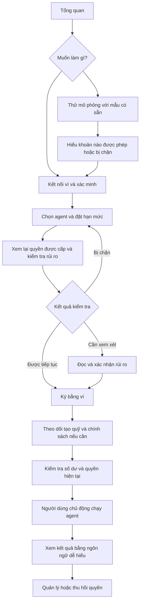

# Kế hoạch chức năng và cải thiện trải nghiệm REDLINE

Trạng thái: P0, P1 và bốn hạng mục P2 (tạo chính sách từ cấu hình cũ, báo cáo, thông báo trong ứng dụng, giải thích lỗi theo ngữ cảnh) đã được triển khai trong source local. Xem [P0](P0_IMPLEMENTATION.md), [P1](P1_IMPLEMENTATION.md) và [P2](P2_IMPLEMENTATION.md). Nghiệm thu với ví, database triển khai, RPC Devnet thật và người dùng mới còn cần thực hiện. Trợ lý hội thoại AI mở rộng và năng lực tài sản/thực thi mới trong phần P2 vẫn là hướng tiếp theo.

## 1. Mục tiêu và phạm vi

Giúp người quản lý quỹ hoặc người dùng mới tự hoàn thành luồng: hiểu sản phẩm → chọn agent → đặt hạn mức → xem lại và ký → chạy thử → hiểu kết quả → thu hồi quyền khi cần.

Giữ năm mục chính hiện tại: **Tổng quan · Agent · Hạn mức chi · Quỹ · Hoạt động**. Chức năng mới xuất hiện trong đúng màn hình tác vụ, tránh tăng số mục trên menu.

Ưu tiên người sử dụng agent trước; phần xuất bản, mô hình, mã định danh và công cụ kiểm thử chuyên sâu vẫn có thể truy cập khi cần. Mọi nút liên quan đến ký hoặc chạy agent cần diễn đạt đúng hành động thực tế.

Giả định làm việc: tiếp tục với Solana Devnet và khả năng backend hiện tại. Hỗ trợ mạng production, thêm tài sản hay thay đổi quy tắc on-chain cần một kế hoạch riêng.

## 2. Phát hiện từ source cần xử lý

| Phát hiện | Ảnh hưởng đến người dùng | Nơi cần xem |
| --- | --- | --- |
| Builder cho chọn nhiều token nhưng phần ký dùng `allowedMints = [USDC_MINT]`. | Người dùng có thể hiểu rằng lựa chọn trên UI chính là quyền đã ký. | `src/app/OperationalPages.tsx`, `src/app/components/GrantSignButton.tsx` |
| Phần ký có thể khởi tạo quỹ và tự nạp token thử nghiệm; onboarding lại có bước nạp quỹ riêng. | Khó biết đã hoàn tất hay còn phải nạp thêm. | `GrantSignButton.tsx`, `OverviewPage.tsx`, `lib/onboarding.ts` |
| Onboarding nhận trạng thái run `running/completed`; runtime kết thúc kịch bản bằng `stopped` với lý do `script complete` trong audit. | Một bước có thể mất dấu hoàn tất sau khi lượt chạy kết thúc. | `lib/onboarding.ts`, `backend/src/runtime/runner.ts` |
| Tiến độ làm quen đang phụ thuộc vào chính sách còn hiệu lực và quỹ còn tiền. | Người đã dùng thành công có thể lại thấy checklist chưa xong khi chính sách hết hạn. | `lib/onboarding.ts` |
| Có ô rút tiền nhưng chưa có kiểm tra riêng đầy đủ trước khi chuyển sang số nguyên token và mở ví. | Số tiền sai, vượt số dư hoặc định dạng không hợp lệ chỉ bị phát hiện muộn. | `components/VaultPanel.tsx` |
| Có chỉ số `Avg/Tx`, trong khi tổng hạn mức không phải giới hạn riêng cho từng giao dịch. | Có thể bị hiểu nhầm là mỗi lệnh chỉ được chi tối đa bằng con số trung bình. | `OperationalPages.tsx`, `lib/risk-engine.ts` |
| Luồng ký có nhiều pha: xác minh, kiểm tra điều kiện, khởi tạo quỹ nếu cần, ký chính sách, ghi nhận backend. | Một thông báo đang tải chung không giúp biết phải làm gì khi bị ngắt giữa chừng. | `components/GrantSignButton.tsx` |
| API dừng lượt chạy đã tồn tại, còn thu hồi quyền là một hành động khác. | Dùng một nhãn “Dừng” cho cả hai sẽ gây hiểu nhầm về quyền còn lại. | `backend/src/routes/runs.ts`, `components/EmergencyStop.tsx` |

Đây là phát hiện từ source, chưa phải kết quả phỏng vấn người dùng. `docs/USER_FEEDBACK.md` hiện là quy trình thu thập phản hồi, không phải bằng chứng các chỉ số usability đã đạt.

## 3. Luồng sử dụng đề xuất

Luồng này nối các màn hình hiện tại bằng nút hành động theo ngữ cảnh. Sau khi tạo chính sách, UI đưa người dùng đến đúng chính sách vừa tạo; sau khi nạp quỹ, có nút quay lại agent đang thiết lập. Không tự chạy agent sau khi ký.

## 4. Đợt 1 — P0: hành vi đúng, rõ ràng, có thể phục hồi

### P0-01 — UI khớp với quyền được ký

- Với phiên bản hiện tại, chỉ hiển thị dUSDC được hỗ trợ ở phần tạo quyền; không cho lựa chọn tài sản không được đưa vào giao dịch ký.
- Dùng chung cấu hình khả năng giữa lựa chọn, bản xem lại, kiểm tra điều kiện và phần dựng giao dịch. Nếu sau này mở nhiều token, phải kiểm tra tương thích cả backend và program.
- Bỏ `Avg/Tx` khỏi màn hình cơ bản. Ghi rõ “Tổng ngân sách cho toàn bộ chính sách”; không mô tả đó là mức chi mỗi lệnh.
- Hiển thị thời hạn thực tế sau khi giới hạn theo thời gian thuê agent. Thay đổi quyền phải khiến kết quả đánh giá cũ hết hiệu lực.

**Nghiệm thu:** asset, người nhận, ngân sách, số lệnh và thời hạn trên bản xem lại trùng với dữ liệu sẽ được ký; không còn lựa chọn chỉ có tác dụng trang trí.

### P0-02 — Trạng thái thiết lập và hướng dẫn đúng bước

- Phân biệt hai thông tin: “đã từng hoàn tất lần đầu” và “hiện đã đủ điều kiện để chạy”.
- Thành công lần đầu cần bằng chứng thanh toán xác nhận; trạng thái `stopped` không mặc nhiên là thành công. Dùng audit hiện có hoặc bổ sung lý do kết thúc có cấu trúc vào API khi cần.
- Tự đánh dấu bước nạp token khi quỹ thực tế đã được nạp trong quá trình tạo chính sách; chỉ yêu cầu nạp khi thực sự thiếu.
- Chính sách hết hạn hoặc bị thu hồi hiển thị hành động tạo chính sách mới, không đưa người cũ trở lại toàn bộ bài hướng dẫn.
- Mỗi khối số dư, quyền và lượt chạy có thể tải hoặc báo lỗi riêng. Một API lỗi không làm mất mọi khối dữ liệu đang dùng được.

**Nghiệm thu:** kiểm tra ví mới, ví đã có quỹ, run hoàn tất, run thất bại, chính sách hết hạn và đổi ví; không có dấu hoàn tất dựa riêng vào việc bấm nút.

### P0-03 — Trải nghiệm ký và phục hồi khi bị ngắt

- Hiển thị tiến trình cụ thể: “Chờ xác nhận trong ví”, “Đang gửi giao dịch”, “Đang xác nhận”, “Đang đồng bộ chính sách”.
- Thông báo trước các yêu cầu ký dự kiến từ trạng thái thực tế; không cam kết luôn chỉ có một chữ ký.
- Khi người dùng từ chối, giữ dữ liệu biểu mẫu và cho thử lại đúng bước.
- Nếu giao dịch đã xác nhận nhưng backend chưa ghi nhận, giữ chữ ký và cung cấp thao tác kiểm tra/đồng bộ lại; không tạo thêm quyền chỉ vì người dùng bấm lại.
- Khóa thao tác gửi trùng ở UI; kiểm tra nhu cầu idempotency và đối soát ở backend trước khi hỗ trợ retry tự động.
- Thành công mở đúng chính sách mới, hiển thị ngân sách, người nhận, thời hạn và nút “Chạy agent”. Nói rõ bản hiện tại chạy kịch bản thử nghiệm có yêu cầu vượt hạn mức.

**Nghiệm thu:** thử từ chối ví, mất mạng trước khi gửi, mất kết nối sau khi gửi, backend lỗi sau khi xác nhận và bấm hai lần; không gửi thêm giao dịch chỉ để khôi phục màn hình.

### P0-04 — Nạp, rút và thu hồi quyền dễ hiểu

- Tách rõ số dư SOL trả phí và dUSDC trong quỹ; ghi rõ môi trường thử nghiệm.
- Kiểm tra số tiền rút: có giá trị, lớn hơn 0, đúng số chữ số thập phân, trong miền số nguyên token và không vượt số dư đã xác minh.
- Chuyển số tiền bằng xử lý chuỗi/số nguyên để tránh sai số do số thực. Nếu số dư không tải được, yêu cầu tải lại trước khi cho xác nhận rút.
- Trước khi rút, hiện số tiền, token, địa chỉ ví nhận; giữ trạng thái chờ xác nhận và liên kết giao dịch sau khi gửi.
- Thu hồi một hoặc nhiều quyền có bản tóm tắt phạm vi; kết quả từng phần phải cho biết quyền nào đã thu hồi và quyền nào chưa xong.
- Nếu sau này đưa thao tác “Dừng lượt chạy” ra UI, ghi rõ nó chỉ dừng lịch đề xuất hiện tại và không thu hồi quyền on-chain.

**Nghiệm thu:** số tiền rỗng, 0, định dạng sai, vượt số dư, thay đổi số dư, từ chối ví và thu hồi thành công một phần đều có thông báo cùng hành động tiếp theo.

### P0-05 — Chuẩn hóa chữ, trạng thái và điện thoại

- Mỗi màn hình có một hành động chính nổi bật; các lựa chọn phụ ở dạng nút nhẹ hoặc mục mở rộng.
- Trạng thái cơ bản: Chưa thiết lập · Sẵn sàng chạy · Đang chạy · Đang chờ · Hết hạn · Đã thu hồi · Cần xử lý.
- Thông báo theo cấu trúc: “Điều gì xảy ra — ảnh hưởng — bước tiếp theo”; mã lỗi kỹ thuật ở phần chi tiết.
- Không chỉ dùng màu để truyền đạt trạng thái. Hỗ trợ bàn phím, thứ tự focus, nhãn đọc màn hình, nội dung dài và cỡ màn hình 360px.
- Chuẩn hóa EN/VI, đơn vị, múi giờ hiển thị và cách gọi “chính sách / hạn mức / lượt chạy”.

**Nghiệm thu:** không có nút bị khóa mà thiếu lý do; không tràn ngang; có thể hoàn thành builder bằng bàn phím; chuyển ngôn ngữ không mất dữ liệu đang nhập.

## 5. Đợt 2 — P1: giảm thao tác lặp và hỗ trợ sử dụng hằng ngày

| ID | Chức năng | Cách thể hiện trong UI | Điều kiện nghiệm thu |
| --- | --- | --- | --- |
| P1-01 | Mẫu cấu hình và bản nháp | Chọn “Bắt đầu từ mẫu” hoặc “Tự cấu hình”; chỉ hỏi dữ liệu bắt buộc, thời gian/số lệnh có phần tùy chỉnh. Lưu nháp theo ví, mạng và phiên bản schema. | Mẫu chỉ điền dữ liệu; vẫn đánh giá lại và ký. Reload không mất nháp; đổi ví không tự áp dụng nháp của ví khác; khôi phục nháp cần xác nhận. |
| P1-02 | Người nhận dễ nhận diện | Nhập tên gợi nhớ, kiểm tra địa chỉ, phát hiện trùng; địa chỉ đầy đủ vẫn có trong bản xem lại. | Tên không thay thế địa chỉ dùng để ký; sửa người nhận hủy kết quả đánh giá cũ; không tự thêm địa chỉ khi dán. |
| P1-03 | Hoạt động dễ đọc | Nhóm theo lượt chạy; diễn giải “Đã chuyển”, “Bị chặn vì vượt ngân sách”, “Đang chờ xác nhận”; lọc theo agent, thời gian, kết quả. | Số tiền và chữ ký liên kết đúng bản ghi; phân biệt bị chặn tại kiểm tra trước với giao dịch bị từ chối on-chain; payload chỉ mở khi cần. |
| P1-04 | Tổng quan cho người quay lại | Ưu tiên việc cần làm: chính sách gần hết hạn, ngân sách sắp cạn, lượt chạy lỗi. Có liên kết đến đúng đối tượng. | Chỉ cảnh báo dựa trên dữ liệu xác minh; cảnh báo cũ được đánh dấu khi dữ liệu mất kết nối; không tạo cảm giác số liệu đang trực tiếp khi đã cũ. |
| P1-05 | Agent của tôi và tìm agent | Danh sách liên quan đến ví là mặc định; có lối sang danh mục agent có sẵn. Xuất bản là hành động phụ dành cho người tạo agent. | Giữ đúng agent đã chọn xuyên suốt; phân biệt agent của mình, đã thuê, hết thời gian thuê và chưa đủ điều kiện dùng; giải thích trước khi mở ví. |

Giai đoạn này tận dụng màn hình và API hiện có trước. Danh bạ người nhận/bản nháp có thể bắt đầu ở thiết bị, kèm mô tả rõ phạm vi lưu và thao tác xóa; không mặc nhiên hứa đồng bộ nhiều thiết bị.

## 6. Đợt 3 — P2: mở rộng sau khi luồng cơ bản đã dễ dùng

- **Tạo chính sách mới từ chính sách cũ:** sao chép dữ liệu để giảm nhập lại; luôn đánh giá và ký mới. Không gọi đây là “sửa” nếu program không hỗ trợ cập nhật quyền hiện hữu. Nói rõ chính sách cũ vẫn có hiệu lực cho đến khi hết hạn hoặc được thu hồi.
- **Nhắc việc trong ứng dụng:** gần hết hạn, lượt chạy thất bại, cần đồng bộ; xử lý được ngay từ thông báo. Kênh email/Telegram chỉ xem xét khi có yêu cầu và lựa chọn đăng ký rõ ràng.
- **Xuất báo cáo hoạt động:** dữ liệu theo ví, bộ lọc đã chọn, thời gian, kết quả và chữ ký; kiểm tra phân quyền và dữ liệu được che trước khi xuất.
- **Trợ lý theo ngữ cảnh:** giải thích lỗi hoặc trường đang nhập; đề xuất sửa đổi cần được người dùng xem lại. Trợ lý không tự ký, nới hạn mức hay chạy agent.
- **Năng lực mới:** thêm tài sản, chế độ LLM hoặc quy tắc thực thi chỉ sau khi có kiểm thử tích hợp tương ứng và UI diễn đạt đúng khả năng thực tế.

## 7. Thứ tự triển khai và phụ thuộc

1. Chốt khả năng token, đơn vị, trạng thái run và nguồn dữ liệu: **P0-01 + P0-02**.
2. Hoàn thiện quyền ký, phục hồi và xác nhận tiền: **P0-03 + P0-04**. Phần retry giao dịch phụ thuộc kết quả rà soát backend, không chỉ sửa UI.
3. Áp dụng ngôn ngữ và các thành phần dùng chung: **P0-05**, xuyên suốt hai bước trên.
4. Kiểm thử Devnet thật bằng ví thử nghiệm của chủ dự án và một buổi thử người dùng trước khi mở P1.
5. Làm **P1-01 → P1-03** để giảm công nhập và đọc kết quả; tiếp đến **P1-04/P1-05** theo vấn đề quan sát được.
6. Chọn P2 từ nhu cầu đã xác minh. Không đưa cả danh sách lên UI cùng lúc.

Ước lượng thời gian cần được chốt sau khi kiểm tra môi trường backend/Devnet và cơ chế đồng bộ giao dịch; tài liệu này thể hiện thứ tự ưu tiên, không phải cam kết ngày phát hành.

## 8. Kiểm chứng trải nghiệm và tiêu chí phát hành

Đề xuất một vòng thử với 5 người mới, coi đây là vòng tìm vấn đề định tính chứ không phải mẫu thống kê đại diện. Ghi nhận các chỉ số sau ở bản hiện tại để có mốc so sánh.

| Bài thử | Đo gì | Mục tiêu đề xuất, chưa phải kết quả đã đạt |
| --- | --- | --- |
| Mở Tổng quan, giải thích sản phẩm | Người thử nói được agent được phép làm gì và chủ ví kiểm soát gì | Ít nhất 4/5 người tự giải thích đúng sau khoảng 30 giây |
| Chọn agent và tạo bản nháp | Tỷ lệ hoàn tất, chỗ dừng, số lần cần hỏi trợ giúp | Ít nhất 4/5 người đi đến bản xem lại mà không cần người hướng dẫn |
| Xem lại quyền trước khi ký | Xác định đúng tổng ngân sách, người nhận, thời hạn và phạm vi token | Ít nhất 4/5 người trả lời đúng cả bốn nội dung |
| Chạy thử và đọc kết quả | Phân biệt đã chuyển, bị chặn, đang chờ | Không nhầm một yêu cầu bị chặn là tiền đã được chuyển |
| Thu hồi quyền | Tìm được thao tác và hiểu hiệu lực sau xác nhận | Ít nhất 4/5 người tìm được trong hai thao tác điều hướng |
| Thử gián đoạn | Khôi phục nháp, từ chối ví, mất mạng, xác nhận chậm | Có đường tiếp tục rõ ràng, không tạo giao dịch trùng |

Tách thời gian người dùng thao tác khỏi thời gian chờ ví, RPC hoặc xác nhận mạng. Tránh đặt mục tiêu tốc độ bằng cách bỏ bước xem lại hoặc tự chấp thuận rủi ro.

Kiểm thử phát hành cần có:

- Unit/integration test cho tiền, trạng thái, dữ liệu theo ví, quyền được ký và phục hồi.
- Browser test trên desktop/mobile với tình huống thành công, rỗng, lỗi, tải chậm, đổi ví và đổi ngôn ngữ.
- Kiểm thử Devnet thực cho tạo quỹ, cấp quyền, chạy, thu hồi và rút; các browser test giả lập hiện có chưa thay thế được phần này.
- Biên bản thử người dùng ghi vấn đề quan sát được; không coi ý kiến nội bộ hay số liệu demo là bằng chứng usability.
- Nếu bổ sung telemetry, chỉ thu thập sự kiện thao tác tối thiểu theo cơ chế đồng ý phù hợp; không ghi seed phrase, khóa, nội dung chữ ký, địa chỉ/số dư vào log phân tích hành vi.

## 9. Phạm vi code dự kiến

| Nhóm | File/module chính |
| --- | --- |
| Điều hướng, ngôn ngữ và bố cục | `src/app/App.tsx`, `src/app/i18n/LanguageContext.tsx`, `src/styles/simple-ui.css` |
| Tổng quan, nguồn dữ liệu và tiến độ | `src/app/components/OverviewPage.tsx`, `src/app/lib/onboarding.ts`, `src/app/lib/useSignedIn.ts` |
| Builder, khả năng token và rủi ro | `src/app/OperationalPages.tsx`, `src/app/lib/risk-engine.ts`, `src/app/components/GrantSignButton.tsx`, `src/app/solana/redline.ts` |
| Quỹ và quyền hoạt động | `src/app/components/VaultPanel.tsx`, `src/app/components/GrantsPanel.tsx`, `src/app/components/EmergencyStop.tsx` |
| Agent, hoạt động và hướng dẫn | `src/app/frontend/Pages.tsx`, `src/app/components/GuidePage.tsx` |
| Hợp đồng API, đối soát và runtime | `src/app/lib/api.ts`, `backend/src/routes/`, `backend/src/runtime/runner.ts` |

Khi triển khai, bổ sung thành phần nhỏ cho trạng thái, thông báo lỗi, số tiền và xác nhận giao dịch; tránh tiếp tục dồn toàn bộ logic vào `OperationalPages.tsx` và `frontend/Pages.tsx`.
